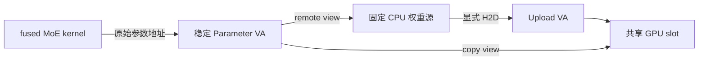

# AdaptMoE 项目梳理与论文对应

核对日期：2026-10-26。

本文结合 *AdaptMoE: Token-Adaptive MoE Inference with Stable Virtual Addresses
and Elastic KV–Expert Memory* 的第 3–5 节与当前源码整理。
本次阅读的本地 PDF SHA-256 为
`e1369e29f9bb2075830d0127995048dc367ba83864cc52473570a6d0b1caca68`。
论文文件留在本地，本文提供可随代码维护的实现说明。

## 1. 系统解决什么问题

显存同时容纳常驻专家、KV、共享搬运缓冲和运行时工作区。KV 需求随上下文和并发
增长；卸载专家越多，GPU 计算时访问 CPU 权重的成本也越大。需要分别决定：

1. 本轮已调度的 token 是否足够多，值得先搬运权重再本地计算；
2. 当前 KV 物理容量是否足够，是否需要卸载更多专家来扩容。

第一个决策每个 scheduler round 都可能变化；第二个决策涉及物理驻留与计划切换，
频率应低得多。两者通过稳定虚拟地址协作，而不是让 fused MoE 算子适配不同指针。

这里的 HBM 泛指代码和论文中的 GPU 本地显存预算；本机 RTX 5090 实际使用 GDDR7。

## 2. 论文概念与代码入口

以下路径以 `workloads/vllm/vllm/` 为 vLLM 根目录。

| 论文概念 | 当前源码 | 主要职责 |
|---|---|---|
| Parameter VA、Upload VA、共享 slot | `vllm/model_executor/models/utils.py` | 精确参数/专家计划、CPU shadow、alias binding、生命周期和 forward 包装 |
| Access Controller | `vllm/v1/worker/gpu_model_runner.py` 的 `_maybe_switch_uvm_original_va_prefill_to_decode_remote` | 读取真实 scheduled tokens，选择 PARK/RESUME，验证切换后状态 |
| 用户态 UVM ABI | `vllm/device_allocator/uvm_static_alias.py`、`uvm.py` | ctypes/ioctl、session、批量迁移和同步 |
| 双视图与 Parent PDE | `kernel-module/nvidia-module/kernel-open/nvidia-uvm/uvm_va_block.c`、`uvm_mmu.c` | 准备离线叶表、发布 parent、维护映射和 TLB |
| 事务接口 | 同目录 `uvm_ioctl.h`、用户态 `uvm_static_alias.py` | REBIND 的 BEGIN/append/COMMIT/ABORT，以及 quiesced delta 接口 |
| Capacity Controller | `vllm/v1/engine/core.py` | 压力估计、档位决策、pending grow/shrink 与安全边界提交 |
| KV 三队列与物理范围 | `vllm/v1/core/block_pool.py`、`uvm_kv_runtime_policy.py` | free/backup/offline 状态、可分配配额、块到 VA 的映射 |
| 专家档位注册 | `vllm/model_executor/models/utils.py` | 预编译 plan class、差集更新、CPU source 和 class 证书 |
| Worker 侧驻留操作 | `vllm/v1/worker/gpu_model_runner.py`、`gpu_worker.py` | KV 初始化、增长/收缩、专家恢复、dual refresh 和启动校验 |
| 混合/阶段调度 | `vllm/v1/core/sched/scheduler.py` | 连续合批；可选 phase-batched cohort；与 KV 管理协作 |

这些文件包含较多早期实验分支。定位新机制时应从上表的入口向下追踪，而不是把所有
`VLLM_UVM_*` 开关同时开启。

## 3. 稳定地址与两条数据路径



本地 copy view 中，上传地址可写、算子读取地址为 consumer alias；两者指向同一
GPU backing。权重按计划填入共享 slot，再由原始 fused MoE kernel 读取。
slot 跨层复用时，必须保持复制、计算及再次覆盖的依赖关系。

remote view 中，同一个 Parameter VA 指向 CPU-backed 权重；kernel 按路由访问
实际需要的权重，经 PCIe 读取。这里的 remote/UVA 不等于 Stock UVM demand paging：
后者依赖缺页与迁移，本机制预先准备目标映射。

PARK 使 copy view 转为 remote view；RESUME 恢复 copy view。
这两种操作保留 session、共享 copy backing 和 Parameter VA，**不会改变 KV 档位**。
只有 Capacity Controller 的容量转换才改变专家常驻集合与 KV 物理配额。

驱动的快速路径先准备两组 4 KiB 叶表，再按 2 MiB VA block 发布相应 parent PDE。
它减少重复构造叶表的工作；stream drain、tracker 等待、TLB 失效和权限维护仍然必要。
“只切页表”不意味着无需 GPU 依赖同步，也不保证所有模型/档位具有相同切换时间。

## 4. 按 token 数切换及 mixed step

`token_threshold` 使用 `scheduler_output.total_num_scheduled_tokens`。
对 mixed step，统计 prefill 与 decode 的总 token 数，整步选择一个访问方式。
它不按请求数、offered QPS 或最大 token bucket 直接决策。

设低阈值为 P、高阈值为 R，且 P < R：

| 当前拓扑 | 本轮 scheduled tokens | 行为 |
|---|---:|---|
| copy / `sealed` | ≤ P | PARK 到 remote |
| copy / `sealed` | > P | 保持 copy |
| remote / `remote_parked` | ≥ R | RESUME 到 copy |
| remote / `remote_parked` | < R | 保持 remote |

P < tokens < R 为滞回区，保留当前模式。默认 P/R 是 64/65；本文复现入口明确使用
16/128。当前使用一对全局冻结阈值，没有自动离线搜索或逐 phase 阈值表的完整实现。

主要配置：

```text
VLLM_UVM_ORIGINAL_VA_PHASE_MODE=token_threshold
VLLM_UVM_ORIGINAL_VA_TOKEN_THRESHOLD=16
VLLM_UVM_ORIGINAL_VA_RESUME_TOKEN_THRESHOLD=128
VLLM_CPU_OFFLOAD_UVM_ORIGINAL_VA_PARK_RESUME=1
VLLM_UVM_PHASE_BATCHED_SCHEDULING=0
VLLM_UVM_PHASE_KV_AWARE_COHORTS=0
```

切换后检查 lifecycle、remote flag、session 和 active backing；失败时 poison 并拒绝
继续执行。旧的按 Prefill/Decode 分阶段模式仍拒绝 mixed step。

性能配置关闭每轮 post-map/hot residency 全量审计，使用已记录的 GPU 完成事件来
建立切换依赖。启动、真实 resize 和故障处理所需的映射/驻留验证仍保留。
控制面优化不能跳过正确性所必需的 PTE、TLB 和 stream 依赖。

## 5. 动态 KV 与专家计划的联动

KV 先保留最大虚拟范围，再限制可分配的物理驻留 prefix。当前实现使用 managed
allocation，inactive tail 可具有 CPU backing；论文中“reserved but unmapped”
不能直接理解为当前每条路径都完全没有 CPU 物理页。

KV block pool 管理三类空闲状态：GPU-free、GPU-backup 和 CPU-offline。它们之外
是请求持有的 active blocks。offlining 不得包含仍被请求使用的尾部块。

控制器综合 active/predicted demand、backup 消耗、抢占和水位信息：高压时提出
增长；持续低压、满足最小驻留与尾部可回收条件时提出收缩。pending 动作在无模型
执行冲突的 scheduler 边界提交，不要求所有请求都完成。

扩大 KV 时，先将专家计划切到更多 cold experts 的档位，再把释放的显存用于 KV。
缩小 KV 时，先回收空闲尾部，再恢复相应专家。不同 plan class 必须满足集合包含、
slot 几何、源数据地址和显存预算等约束。

### 当前公开复现的 K1/K2 配对

模型为 DeepSeek-V2-Lite-Chat BF16，26 个 MoE 层，每层 64 个专家。
MLA 每个 token 的模型级 KV 为 31,104 B；block size=16，故每块 497,664 B。
每层 block 为 18,432 B，要按两块对齐才能满足 4 KiB 驻留/迁移边界，另保留 null block。

| 档位 | 可用 KV blocks | 可用 KV tokens | 每层卸载专家 | 卸载主权重 bytes |
|---|---:|---:|---:|---:|
| K1（约 1 GiB） | 2,155 | 34,480 | cold8 | 3,598,712,832 |
| K2（约 2 GiB） | 4,313 | 69,008 | cold11 | 4,948,230,144 |

固定 AdaptMoE 和动态 AdaptMoE 均保留相同 K2 最大 VA；固定组仅 K1 驻留/可分配，
动态组可在 K1/K2 之间变化。动态组保留 80% 高水位、4 step 最小驻留和 3 step
低压确认。实际是否变化由运行时压力决定，不能因为 configured K1→K2 就宣称发生扩容。

Native UVA 与 Native Copy 保持原生 whole-Parameter 粒度：同一组 7 个 Parameter，
3,690,987,520 B，比 AdaptMoE cold8 多 2.56%。可用固定 KV token 数已对齐；
这是系统配置比较，不能单独归因为纯 copy/UVA 传输机制差异。

### 本次同步的容量修复

- 超出单次 ioctl entry 上限的 quiesced delta 被拆为有界批次；需要时保持 backing
  identity 完整，失败仍进入恢复或拒绝服务路径。
- KV grow 前预备双视图页表，避免 KV 占满释放的显存后再分配页表失败。
- grow 后在安全边界恢复 hot expert 驻留，并检查恢复没有挤出 active KV；随后刷新
  普通页映射，避免已迁移的 hot page 留下旧物理地址。
- detached page-table 分配可回收完全空闲的 USER root chunk 后重试 KERNEL 分配；
  该重试不逐出仍驻留的 live managed page。
- lazy KV reserve 仅作用于 KV tensor；attention workspace 仍先保证驻留。嵌套同一
  CUDA MemPool 时复用外层 recording，避免 PyTorch 重复录制同一池。

事务保障有明确边界：代码提供 REBIND 和差集/rollback 机制，但不可恢复错误会
poison/fail-closed。不能将论文的事务抽象推广成“任意 OOM 后都能无条件恢复服务”。

## 6. CUDA Graph 支持边界

| 当前模式 | 允许 mixed | Graph 要求 | 说明 |
|---|---|---|---|
| `token_threshold` | 是 | `NONE`，eager | 当前公开混合调度基线 |
| `prefill_graph_remote_decode` | 否 | `FULL_SEPARATE` | 独立 Prefill/Decode graph，切换在 replay 外 |
| `prefill_remote_decode` | 否 | eager phase path | 早期严格阶段/cohort 实验路径 |

`validate_cpu_offload_graph_static_alias_runtime()` 明确拒绝
`token_threshold + CUDA Graph`。稳定参数地址是 Graph 兼容性的必要条件，但不能消除
batch layout、token bucket、attention metadata 和 copy-node 依赖等约束。
论文描述的 token-adaptive Graph 路径不应视为当前 mixed-step 模式已完成的功能。

另一个同步的 Graph 修复是 MLA pure-prefill metadata 复用 runner 持有的持久输入
buffer，避免 Graph 捕获临时 subtraction tensor 的地址后读取被回收的 storage。

## 7. 实验入口与证据应如何解读

[当前复现入口](../experiments/adaptmoe_token_threshold_sharegpt_compare/README.md)
运行固定 trace 的四个配置，默认每个机制一次进程，关闭 Graph。
它复用现有 runner、物理驻留审计和 verifier，不依赖本地历史 artifact。

旧的实验入口按主题仍可使用：

| 主题 | 入口 |
|---|---|
| 稳定 VA / alias 最小验证 | `experiments/uvm_static_alias_original_va/` |
| 原始 VA 与 Graph 集成 | `experiments/vllm_uvm_original_va_graph_integration/` |
| Prefill/Decode 双视图与阶段切换 | `experiments/vllm_uvm_prefill_alias_decode_remote_graph/` |
| 离散容量与双向 round trip | `experiments/eurosys_moe_offload_evaluation/e13/` |
| 逐层 cold expert 与整层 placement | `experiments/eurosys_moe_offload_evaluation/e14/`，本地历史实验 |
| 较早 E0–E14 复现索引 | `experiments/reproduce/README.md` |

较早索引中的日期、模块指纹和固定参数属于当时协议；不能跨模型、backend、Graph
模式、预热或 expert/KV 配额拼接成一个公平排名。

最新同配置实验显示，低负载时动态组可能完全不扩容；高负载时增大 KV 可以提高
吞吐、缩短排队 TTFT，但更多 cold experts 和更大合批也可能提高 TPOT/E2E。
因此“动态 KV 优于固定 KV”必须附指标与负载条件。

完整输出 hash 和首 token 都需要核对。已有运行出现过输出漂移；请求成功或没有
GPU fault 不足以证明数值等价。verifier 将这类结果标记为 `ok_with_output_drift`。
论文中的速度倍率属于其对应实验，不作为本次代码整理重新验证的结果。

## 8. 上传范围与本地保留

此次增量发布包含核心运行时/驱动修复、回归测试、必要的共享 runner、四机制实验
依赖、一个冻结 token-ID trace 与新文档。未将所有调试脚本、旧测量报告、模型、完整
数据集、profile、日志或 artifact 整体加入 Git。

本地 PDF、`my_paper/`、压缩包、编辑器配置、原始实验目录及尚未整理的代码保留在
原处；仅添加必要的 ignore 规则并明确选择暂存文件。已有历史受控内容未批量删除或
改写历史；KTransformers 的本地修改也没有作为一个未发布的子模块指针上传。

原有 `docs/moe_phase_aware_offload_technical_design.md` 是 2026-08-24 阶段快照，
其“尚不支持 mixed step”等结论应结合本文所述的新增 `token_threshold` 分支阅读。
