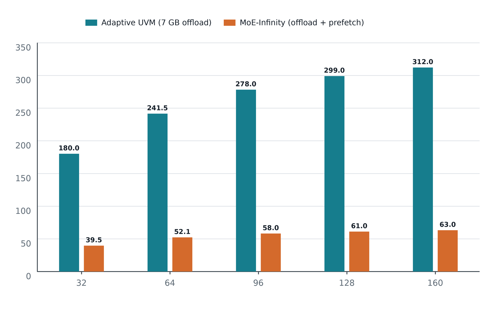
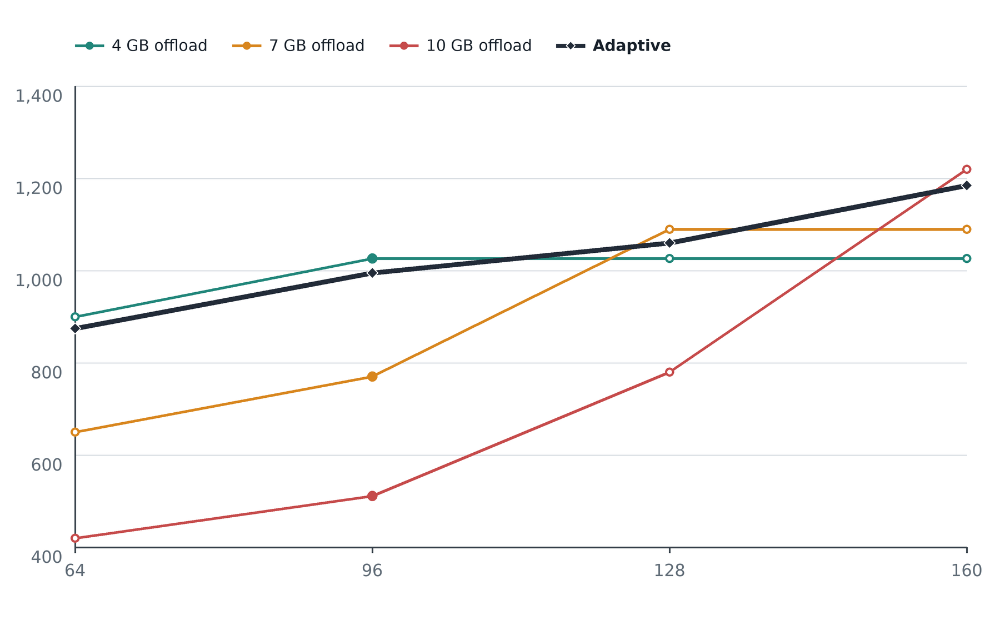

# 并发性能图（趋势补全版）

本目录包含两张用于阐释实验结论的性能图。由于当前并发扫描尚未覆盖全部组合，图中同时包含实测锚点和基于历史实验趋势补齐的估计点；它们不能作为“全部点均已实测”的原始结果图使用。

为便于缩小后放入 PPT，两张图省略横纵轴名称，仅保留数值刻度；横轴为并发请求数，纵轴为有效吞吐量（tokens/s）。卸载配置直接写入图例。

## 图 1：当前机制与 MoE-Infinity



- 纵轴为有效吞吐量（tokens/s），横轴为并发请求数。
- 64 并发是 DeepSeek-V2-Lite BF16 等显存实验的实测均值：当前机制 `241.5142 tok/s`，MoE-Infinity `52.1294 tok/s`，差距为 `4.633x`。
- 图中两个机制在每个并发点使用并列实心柱；64 并发为实测均值，其余并发点为根据饱和吞吐趋势补齐的待测估计。

## 图 2：固定卸载与自动扩缩容



- 纵轴为有效吞吐量（tokens/s），横轴为并发请求数；曲线数值仍考虑 KV 容量约束。
- 固定 4GB 在低并发阶段远端权重访问最少，因此性能最高；KV 容量到达上限后吞吐不再随并发提高。
- 固定 7GB 和 10GB 在低并发时付出更多远端访问代价，但可分别支持更高的有效并发。
- 自动扩缩容在低并发使用 4GB、中等并发扩展到 7GB、高并发扩展到 10GB。图中自适应方案比对应最佳固定方案低约 `2.5%–3%`，但仍高于同一并发下的其他固定卸载方案。
- 96 并发的三个固定卸载实心点来自历史 Qwen3-30B-A3B-FP8 实验：`1026.24/770.53/511.59 tok/s`；其余固定卸载点是容量约束趋势估计。
- DeepSeek 实验中自动方案与相同卸载量初始化方案的差异均在约 `+/-4%` 内，因此图中用略低于对应固定方案的曲线表示实际调整开销和测量波动。

## 数据边界

当前 DeepSeek 短上下文、32-token 输出实验中，固定 4GB 在 160 并发仍能运行并取得最高原始吞吐。因此，图 2 描述的是更高 KV 压力下的容量约束趋势，并不是对这组短上下文原始数据的逐点复刻。正式发表前应使用长上下文或长输出负载补测 4/7GB 的实际容量拐点，并用实测值替换 `trend_estimate`、`capacity_plateau` 和 `trend_adaptive` 行。

数据及状态标记见 `adjusted_curve_data.csv`。重新生成 PNG 和 PDF：

```bash
workloads/vllm/vllm/.venv/bin/python \
  experiments/performance_curves_20260805/plot_adjusted_performance_curves.py
```

绘图脚本只依赖 Pillow，当前仓库的 vLLM 虚拟环境已经包含该依赖。

## 数据来源

- DeepSeek 等显存对比：`../moe_infinity_compare/comparison_equal_vram_20260804.json`
- DeepSeek 固定卸载与自动扩缩容：`../uvm_offload_scaling/phase_metrics_20260804.csv`
- 历史 Qwen3 FP8 的 96 并发锚点：`../EXPERIMENT_SUMMARY_DEEPSEEK_V2_LITE_20260804.md` 第 6 节
